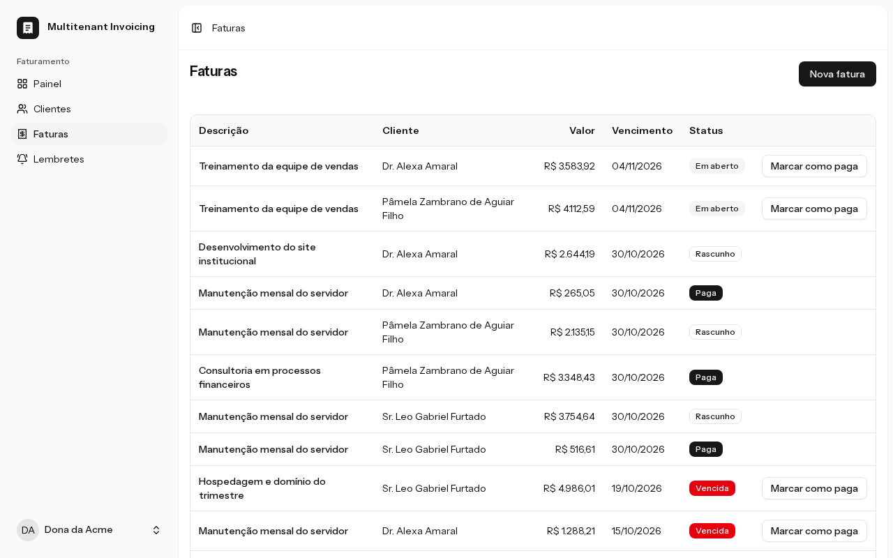
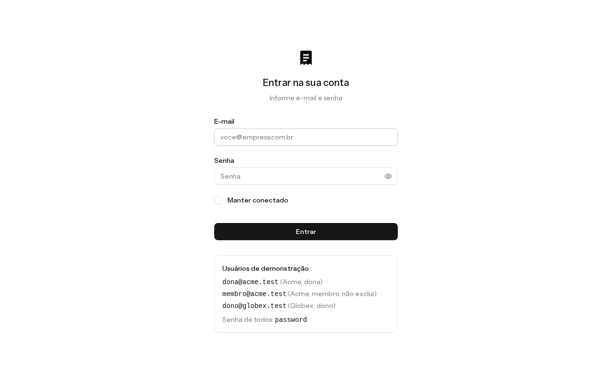
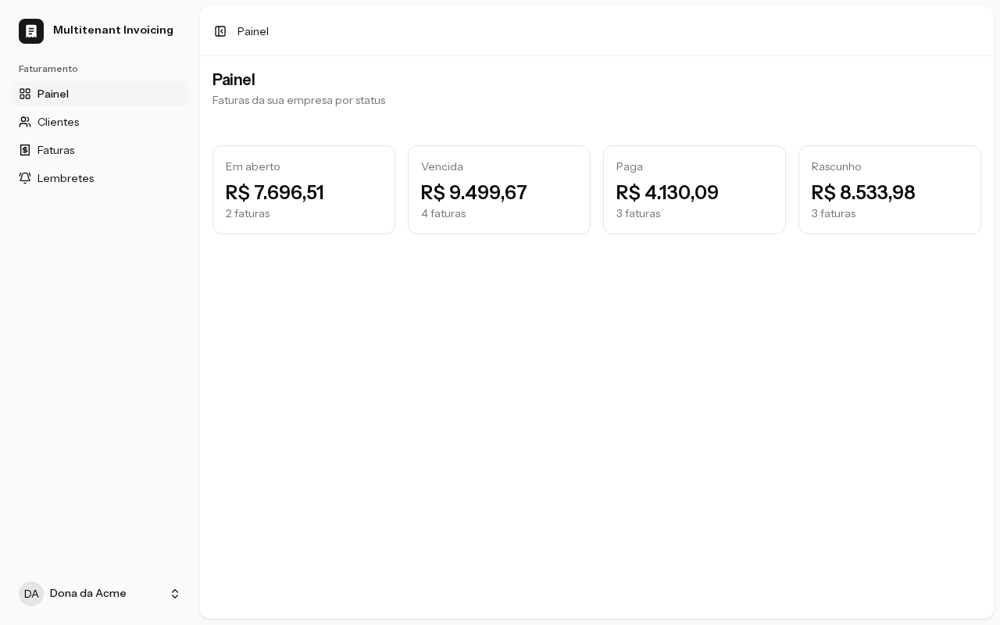
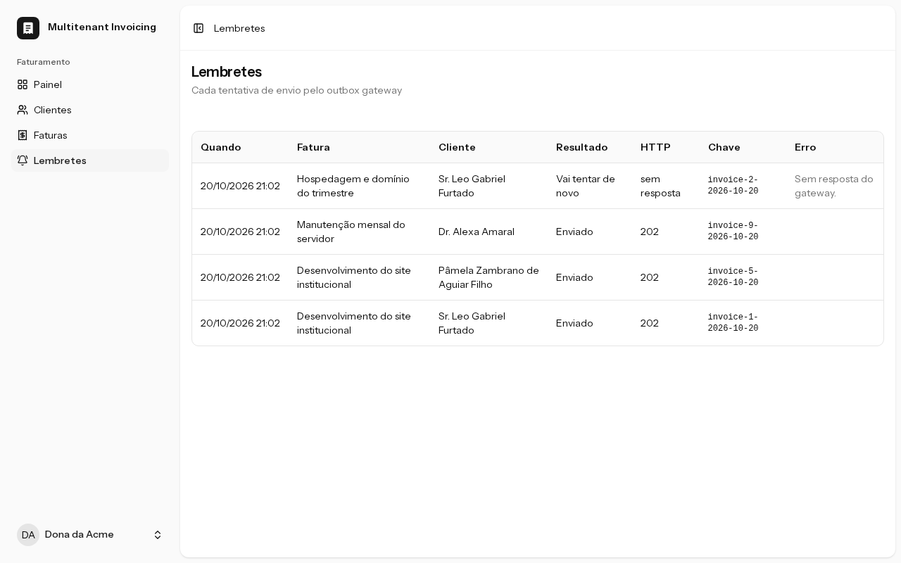

# multitenant-invoicing

[](https://github.com/MiguelSanzBr/multitenant-invoicing/actions/workflows/ci.yml)


[](LICENSE)

Small multi-tenant invoicing SaaS in Laravel 13 + Inertia + React. Each company has its own users (owner or member), clients and invoices in BRL. Every day a command marks overdue invoices and sends a WhatsApp reminder through [outbox-gateway-demo](https://github.com/MiguelSanzBr/outbox-gateway-demo), my other project.

[Versão em português](README.md)



**The problem.** In a SaaS with many companies in the same database, the two bugs that hurt the most are one company seeing another company's data and a customer getting the same charge twice. I saw both in production. This repo is the design I'd go with today so neither happens, with a test that breaks if someone removes the protection.

**What it guarantees:**

- A user only sees their own company, on the web and on the API. Another company's id returns 404, same as an id that doesn't exist.
- The database checks it too: an invoice can't point to another company's client, a reminder can't point to another company's invoice (composite FK).
- One reminder per invoice per day, even with queue retries, the command running twice or a worker dying mid-send.
- A payment made while the daily command runs is not undone (conditional UPDATE and optimistic locking).
- The SMS channel has a ceiling: at most 3 reminders per invoice and a daily quota per company.

## How to run

All you need is Docker.

```bash
docker compose up -d --build   # app, Postgres 17, queue, scheduler, Vite build and the demo seed
```

Open http://localhost:8000. The login screen lists the demo users (password `password` for all of them):

| E-mail | Company | Role |
|---|---|---|
| dona@acme.test | Acme | owner |
| membro@acme.test | Acme | member (can't delete) |
| dono@globex.test | Globex | owner |

Log in as Acme and as Globex to see that neither can see the other. Details (UID/GID, reminders, API, production image) in [Running in detail](#running-in-detail).

| Login with the demo users | Dashboard | Reminders |
|---|---|---|
|  |  |  |

## Why this repo exists

It takes two lessons from my day job into public code:

1. **Cross-tenant IDOR leak in a CRM.** Changing the id in the URL was enough to see another company's data. Here isolation doesn't depend on every controller remembering to filter: the filter lives in the model, fails closed and the database checks again.
2. **Duplicate send caused by a queue retry.** The job was slow, the queue assumed it had died, handed it out again and the message went out twice. Here the job is unique per invoice and per day, the queue `retry_after` is larger than the job `timeout`, and the send carries an idempotency key so the gateway drops repeats.

Both are solved in the design, and each one has a test that breaks if someone removes the protection (see [Mutation check](#mutation-check)).

## Architecture

Hexagonal, the Laravel way: the domain is plain PHP in the center, the framework stays at the edges.

```
                 ┌──────────────────────────── Http / Console (inbound adapters) ────────────────┐
                 │  Web controllers (Inertia)  ·  API /api/v1 (Sanctum)  ·  invoices:mark-overdue │
                 └───────────────┬───────────────────────────────────────────────┬───────────────┘
                                 │ writes                                        │ reads
                                 ▼                                               │ (Eloquent with the
                 ┌─────────── Application (use cases) ──────────────┐            │  tenant scope, out
                 │ CreateInvoice · UpdateInvoice · MarkInvoicePaid  │            │  through Resources)
                 │ DeleteInvoice · CreateClient · UpdateClient      │            │
                 │ DeleteClient · MarkOverdueInvoices               │            │
                 │ SendInvoiceReminder                              │            │
                 └───────────────┬──────────────────────────────────┘            │
                                 ▼                                               │
                 ┌──────────────── Domain (plain PHP) ──────────────┐            │
                 │ Invoice (draft→open→paid/overdue) · Client       │            │
                 │ Money · DueDate · PhoneNumber · IdempotencyKey   │            │
                 │ ReminderLimits                                   │            │
                 │ ports: InvoiceRepository · ClientRepository      │            │
                 │ CrossTenantInvoices · CrossTenantClients         │            │
                 │ ReminderSender · ReminderLog · ReminderQueue     │            │
                 │ TenantContext                                    │            │
                 └───────────────▲──────────────────────────────────┘            │
                                 │ implements                                    ▼
                 ┌──────────────── Infrastructure (outbound adapters) ───────────────────────────┐
                 │ Eloquent models + tenant scope · Eloquent repositories                        │
                 │ OutboxReminderSender (HTTP) · queue jobs · AuthTenantContext                   │
                 └────────────────────────────────────────────────────────────────────────────────┘
```

- `app/Domain`: entities, value objects and interfaces. No `Illuminate`, `Carbon` or other layer. An invoice only changes status through a method (`open`, `revertToDraft`, `markPaid`, `markOverdue`) and rejects an invalid transition with `RuleViolation`. Editing only touches the data. A value object with an invalid value throws `InvalidValue` (422).
- `app/Application`: one use case per class, depending only on the domain ports.
- `app/Infrastructure`: Eloquent, queue, HTTP and auth. The global tenant scope lives here because it's a persistence detail.
- `app/Http` and `app/Console`: controllers, policies, form requests, resources and the daily command. Every write goes through a use case.

The dependency rule is checked by Pest architecture tests (`tests/Unit/ArchTest.php`): domain and application without the framework, `Http` not using outbound adapters directly, `declare(strict_types=1)` in every file, final domain classes, and only the daily command and the reminder job using the ports that cross companies.

**Why like this.** The rules that matter (status transitions, amounts in cents, the idempotency key, what to do with each gateway response) are testable without a database or HTTP, with in-memory repositories. Laravel keeps doing what it does well: routing, validation, queues, Eloquent.

**Where I was pragmatic.** Reads (lists, dashboard, history) go straight to Eloquent inside the controller, with the tenant scope applied, and come out through the same Resources as the API. A use case and a DTO for each listing would be ceremony with no rule inside. Policies stay as "who can" authorization (same company, owner to delete) and the domain answers "can it, in this state?".

## Tenant isolation

- `BelongsToCompany` (trait) + `CompanyScope` (global scope) on every model with `company_id`: `Client`, `Invoice` and `Reminder`.
- With a logged-in user the query filters by their company. **Without a user the scope returns nothing**, not everything.
- The job and the command that need to cross companies use separate ports (`CrossTenantInvoices`, `CrossTenantClients`). An arch test locks who can use them: only `MarkOverdueInvoices`, `SendInvoiceReminder` and the adapters. A screen use case can't get them even by mistake.
- On create, `company_id` always comes from the logged-in user and the payload value is ignored. Tenant models have no `fillable`: writes only go through the repository.
- Route model binding goes through the scope, so another company's id becomes a 404, same as a missing id.
- The invoice `client_id` is validated against the user's company in the form request and again in the use case.
- In the database: `unique(company_id, id)` and composite FKs `invoices(company_id, client_id)` and `reminders(company_id, invoice_id)`, plus CHECKs for a positive amount, a valid status and `paid_at` only when paid. The reminder job still checks that client and invoice belong to the same company before sending the SMS.
- Policies on every action, web and API, with a test for each one through both entry points.
- A test walks `app/Infrastructure/Persistence/Models` and fails if any model with `company_id` doesn't use the scope. `User` is the only exception, because login looks up the user before there's a tenant.
- Inertia props come out through the Resources: `company_id`, timestamps and any new column don't reach the HTML by default.

## Idempotent reminders and outbox-gateway-demo

```
09:00 invoices:mark-overdue (onOneServer, 60 min mutex)
          │
          ├─ UPDATE invoices SET status='overdue' WHERE status='open' AND due_date < today   (a single statement)
          │
          └─ overdue ids in chunks of 500 (lazyById) → one QueueInvoiceRemindersJob per chunk
                  └─ one SendInvoiceReminderJob(invoice_id, day) per invoice
                        ShouldBeUnique, uniqueId = invoice-{id}-{Y-m-d}
                        timeout 30s, queue retry_after 90s, backoff 60/300/900/3600s, 12h deadline
                        circuit breaker: 10 failures in a row and the next ones go back to the queue for 5 min without calling
                        │
                        ▼
              SendInvoiceReminder (use case)
                ├─ invoice no longer overdue? don't send
                ├─ already a delivered send with this key? don't send
                ├─ invoice already got 3 reminders or the company hit today's quota? don't send
                ├─ client from another company? fail the job, no SMS
                └─ POST {OUTBOX_URL}/v1/messages
                      Idempotency-Key: {app}-{env}-invoice-{id}-{Y-m-d}
                      {"recipient": <client phone>, "body": <text>}
                        ├─ 202/200 → sent
                        ├─ 409     → already_sent (the gateway already has the key)
                        ├─ 5xx, 408, 429 or no response → retry_later, back to the queue (honours Retry-After)
                        └─ other 4xx → rejected, the job fails without retry
              every attempt becomes a row in the reminders table
```

What stops the duplicate, in layers:

1. **Unique lock** per invoice and per day: running the command twice doesn't queue the same reminder twice.
2. **`retry_after` (90s) larger than the job `timeout` (30s)**, and the HTTP timeout (10s, 2s to connect) smaller than both. That's exactly what caused the duplicate I saw: with a smaller `retry_after`, the queue hands the job to another worker while the first one is still waiting for the response. A test reads the config and compares, and another checks that the HTTP client uses those timeouts.
3. **The key is the day it was queued**, not the day it ran. A retry after midnight reuses the key and the gateway drops it. At the gateway the key carries app and environment (`OUTBOX_KEY_PREFIX`), so staging and production sharing one outbox don't collide.
4. **Local log**: if there's already a `sent` or `already_sent` for the key, the job doesn't even call the gateway. In the database, a partial unique index guarantees at most one `sent` per key.
5. **The gateway** drops resends by `Idempotency-Key`. It's the last barrier for a crash between the gateway accepting and the log being written.

The raw gateway error (internal host, response body) only goes to the server log. The tenant's reminder history shows a summary like "Gateway respondeu HTTP 422.".

Without the gateway running the send gets a connection error, becomes `retry_later` and the job goes back to the queue. Compose has an optional profile that brings up the gateway and the provider mock, pinned to a commit of the other repo.

## Tests

| Guarantee | Test |
|---|---|
| A user only sees their own company's data; without a user the scope returns nothing | `tests/Feature/TenancyTest.php` |
| `company_id` comes from the user and ignores the payload; tenant models refuse mass assignment | `TenancyTest` |
| Every model with `company_id` uses the scope | `TenancyTest` › todo model com company_id usa o escopo de tenant |
| Web and API IDOR: viewing, editing, paying and deleting another company's records returns 404 and nothing changes; lists only show your own company (which also has data in the test) | `tests/Feature/IdorTest.php` |
| Who can do what, on every action, on the web and the API | `tests/Feature/PolicyTest.php` |
| The database rejects invoices and reminders crossing companies, zero amounts, made-up statuses and two `sent` with the same key | `tests/Feature/SchemaTest.php` |
| Explicit status transitions, editing doesn't touch status, a rescheduled overdue invoice goes back to open | `tests/Unit/Domain/InvoiceTest.php`, `tests/Unit/Application/BillingUseCasesTest.php` |
| A payment between loading and saving is not undone (optimistic locking) | `tests/Feature/InvoicesTest.php` |
| The command marks overdue invoices in a single UPDATE and queues in chunks | `tests/Feature/RemindersTest.php` |
| Send with a prefixed `Idempotency-Key`, the expected JSON, timeouts from config | `RemindersTest` |
| 202/200 ok, 409 already sent, 5xx/408/429/timeout retried with Retry-After, other 4xx fails | `RemindersTest` |
| Real `database` queue: backoff in `available_at`, lock released, `failed_jobs`, circuit breaker and the 12h deadline | `tests/Feature/ReminderQueueTest.php` |
| The reminder log fake behaves like the Eloquent one | `tests/Feature/ReminderLogContractTest.php` |
| 3 reminders per invoice ceiling and daily quota per company | `tests/Unit/Application/RemindersUseCasesTest.php` |
| Read-only token by default, abilities per route, listing, revocation, fake hash for unknown e-mails and limits | `tests/Feature/TokenTest.php` |
| Security headers, the seed refusing production, Inertia props through Resources | `SecurityHeadersTest`, `SeedAndLocaleTest`, `InertiaPropsTest` |
| Architecture (layers, ports, strict types) and `openapi.yaml` matching the routes | `tests/Unit/ArchTest.php`, `tests/Feature/OpenApiTest.php` |
| React pages (login, dashboard, clients, invoices, reminders) | `tests/js/**` with Vitest + Testing Library |

That's 275 PHP tests (1045 assertions) against a real Postgres (`invoicing_test`), never SQLite, and 44 frontend tests. phpunit fails on warnings.

### Coverage

- **PHP:** Pest with pcov and `--coverage --min=100` over `app/`. No file excluded.
- **Frontend:** Vitest with a 100% threshold on lines, branches, functions and statements over the whole of `resources/js`. Only what Wayfinder writes (`actions/`, `routes/`, `wayfinder/`) and what came ready from the starter kit stay out: `components/ui/*`, `layouts/*`, `hooks/*`, `types/*`, `lib/utils.ts`, `app.tsx` and the shell components (sidebar, user menu, breadcrumbs, logo). A new file enters the gate by itself.

### Mutation check

Two layers in the CI `mutation` job:

1. `scripts/mutation-check.sh` breaks each main protection on purpose (including config and `implements ShouldBeUnique`, which no tool mutates), runs the whole suite and restores the file, even if interrupted. Real output from the last run:

```
PEGO   sem escopo de tenant ->  Tests:    17 failed, 258 passed (991 assertions)
PEGO   escopo aberto sem usuário ->  Tests:    1 failed, 274 passed (1044 assertions)
PEGO   sem lock único no job ->  Tests:    1 failed, 274 passed (1043 assertions)
PEGO   envio sem Idempotency-Key ->  Tests:    2 failed, 273 passed (1044 assertions)
PEGO   4xx tratado como retry ->  Tests:    7 failed, 268 passed (1034 assertions)
PEGO   retry_after menor q o timeout ->  Tests:    1 failed, 274 passed (1043 assertions)
```

2. `pest --mutate` over `Domain`, `Application` and `Infrastructure` with `--min=97`. It started at 83.4% (37 mutants escaping). I killed the meaningful ones (edge limits, a Retry-After in the past, the quota day window, saving without a logged-in user...) and it's now at **98.09%** (308 of 314 caught, 2 of them by timeout). The 6 left are equivalent: a redundant Eloquent cast and a path where the worker's backoff fallback gives the same result.

## Known limits

- Compose is for development: bind mount, `artisan serve`, a weak Postgres password (only on 127.0.0.1). For production there's the `prod` target in `docker/Dockerfile` (FrankenPHP, opcache, non-root, healthcheck), but no ready deploy: database, secrets and HTTPS are up to whoever runs it. In production use a strong `DB_PASSWORD` and `SESSION_SECURE_COOKIE=true`.
- There's no user sign-up or invite: companies and users come from the seed. I also removed password reset, e-mail verification, 2FA and passkeys from the starter kit. With no password change there's no token revocation on it; the user revokes with `DELETE /api/v1/tokens/current` and the token expires in 30 days.
- A paid invoice can be deleted by the owner. There's no soft delete or audit trail, so its history goes with it (including its reminders).
- In practice BRL only. `Money` accepts another currency and editing keeps the invoice currency, but the UI and the form assume reais.
- Timezone fixed to `America/Sao_Paulo` (`APP_TIMEZONE`), which defines what "overdue today" means. The daily quota per company counts by the time the reminder went out.
- The key is per invoice and per day. If someone edits the invoice after the day's reminder, the local log already has the key and nothing goes out; even if it reached the gateway, it would answer 409 (same key with different content), which counts as already sent. The reminder with the fixed amount only goes out the next day.
- The reminder text is in Portuguese with the invoice's free-form description, with no opt-out and no approved WhatsApp template. The per-invoice ceiling and the per-company quota limit abuse, but don't filter links in the text. The demo gateway delivers to a mock.
- The unique lock uses the cache (`database` driver in compose). If the cache is cleared with a job queued, the lock is gone, and what's left is the local log, the unique `sent` index and the key at the gateway.
- An overdue invoice goes back to "open" when the due date is rescheduled to today or later. With the date still in the past it stays overdue; it doesn't go back to draft.
- CSP only with `frame-ancestors`: the inline theme script and Vite need an extra step for a full policy.
- On mobile the tables scroll horizontally inside the card.
- In the frontend tests, Inertia's `Head`, `Link` and `usePage` are replaced with simple versions; `useForm` and `router` are the real ones, only spied on.

## Running in detail

The code goes into the container through a bind mount and the image runs as UID/GID 1000 by default. If your user is different, pass the ids on build (in bash `UID` exists but isn't exported and in zsh it's special, so it goes with `env` on the command line):

```bash
env UID=$(id -u) GID=$(id -g) docker compose up -d --build
```

On the first start `setup` migrates and seeds the demo; after that it only migrates. To start over: `docker compose exec app php artisan migrate:fresh --seed`.

Postgres is exposed on the host only on `127.0.0.1:5434` (not 5432, so it doesn't clash with another local Postgres): `psql -h localhost -p 5434 -U invoicing invoicing`, password `invoicing`. Ports change with `APP_PORT` and `DB_PORT_HOST`.

Reminders:

```bash
docker compose --profile outbox up -d                       # optional: brings up outbox-gateway-demo and the mock
docker compose exec app php artisan invoices:mark-overdue   # the scheduler already runs it every day at 9am
```

The `outbox` profile uses the `outbox` database created by the Postgres init script. If the volume existed before, create it with `docker compose exec db createdb -U invoicing outbox`.

API (the token comes out read-only; to write, ask for `"abilities": ["invoices:write"]`):

```bash
TOKEN=$(curl -s -X POST localhost:8000/api/v1/tokens -H 'Content-Type: application/json' -H 'Accept: application/json' \
  -d '{"email":"dona@acme.test","password":"password","device_name":"cli"}' | sed -E 's/.*"token":"([^"]+)".*/\1/')
curl -s localhost:8000/api/v1/invoices -H "Authorization: Bearer $TOKEN" -H 'Accept: application/json'
curl -s -X DELETE localhost:8000/api/v1/tokens/current -H "Authorization: Bearer $TOKEN" -H 'Accept: application/json'
```

The token lasts 30 days (`SANCTUM_EXPIRATION`, in minutes), has the `mti_` prefix for GitHub secret scanning and expired ones are pruned every day. The authenticated API accepts 60 requests per minute per user; issuing tokens, 6 per minute per IP and per e-mail. The contract with examples is in [`openapi.yaml`](openapi.yaml) ([open in Swagger Editor](https://editor.swagger.io/?url=https://raw.githubusercontent.com/MiguelSanzBr/multitenant-invoicing/main/openapi.yaml)).

Production image:

```bash
docker build -f docker/Dockerfile --target prod -t multitenant-invoicing:prod .
docker run -p 8080:8080 -e APP_KEY=base64:... -e DB_HOST=... -e DB_PASSWORD=... multitenant-invoicing:prod
```

Quality checks, all inside the container:

```bash
docker compose exec app vendor/bin/pint --test
docker compose exec app vendor/bin/phpstan analyse --memory-limit=1G
docker compose exec app vendor/bin/pest --coverage --min=100
docker compose exec app vendor/bin/pest --mutate --path=app/Domain,app/Application,app/Infrastructure --covered-only --parallel --min=97
docker compose exec app sh scripts/mutation-check.sh
docker compose exec app sh -c 'php artisan wayfinder:generate --with-form && npm run lint && npm run types:check && npm run test:coverage && npm run build'
```

End to end, with the whole stack and the real outbox-gateway-demo (login, API with and without a token, a read-only token not writing, the reminder reaching the gateway with the right key and a second run on the same day without duplicating). It uses a different compose project name and different ports (18000 and 15434), so it runs with the dev stack up without touching your database. If it fails, the logs of every service go to `e2e-logs.txt`:

```bash
bash scripts/e2e.sh
```

CI (`.github/workflows/ci.yml`) runs all of this in 5 jobs: `backend` (Pint, Larastan level max, Pest with 100%), `frontend` (ESLint, types, Vitest with 100%, build), `mutation` (the 6 protections and `pest --mutate` with a 97% minimum), `image` (builds the `prod` target and waits for the healthcheck) and `e2e` (`scripts/e2e.sh`, with the logs as an artifact when it fails). Actions pinned by SHA, runner fixed on `ubuntu-24.04` and Dependabot for actions, composer, npm and Docker images.

## License

MIT, see [LICENSE](LICENSE).
